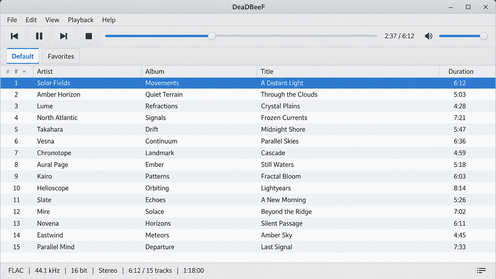
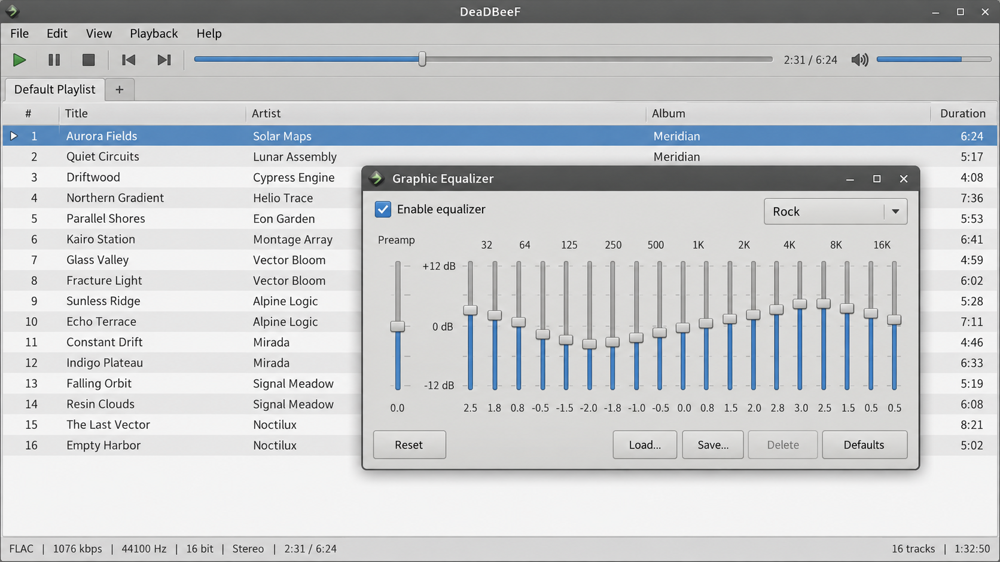
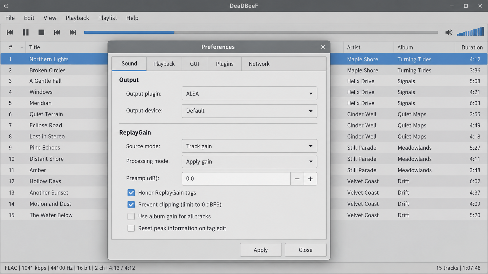

# Deadbeef Music Player - Lightweight Modular Audio Player

## About

**Deadbeef Music Player** is a lightweight, modular desktop audio player maintained under the **Deadbeef Media Player** organization. It provides local music playback, playlist management, audio conversion, configurable output, metadata handling, and a plugin-oriented C codebase.

The Deadbeef open source music player targets Linux, Windows, macOS, BSD, and similar desktop systems. Its name comes from the hexadecimal value `0xDEADBEEF`.



### Project Vocabulary

deadbeef music player, deadbeef music player linux, deadbeef music player windows, deadbeef music player plugins, deadbeef music player configuration, deadbeef music player source code, music-player, audio-player, media-player, cross-platform, open-source, plugin-system, audio-converter, linux, c-language

## Resources

- Build definition: [CMakeLists.txt](CMakeLists.txt)
- Change history: [CHANGELOG.md](CHANGELOG.md)
- Contributors: [AUTHORS](AUTHORS)
- Contribution guide: [CONTRIBUTING.md](CONTRIBUTING.md)
- Code of Conduct: [CODE_OF_CONDUCT.md](CODE_OF_CONDUCT.md)
- License terms: [COPYING](COPYING)

## Overview

The **Deadbeef Media Player** project is organized around a compact playback core and replaceable components. **Deadbeef Music Player** separates playlists, queues, media-library management, output, decoding, DSP processing, configuration, artwork, and conversion into focused modules.

The core remains suitable for resource-conscious desktop systems while supporting broad music collections. A configurable interface and plugin system let users adapt the Deadbeef custom layout, output path, decoder selection, and playback behavior without replacing the player core.

### What is the best free music player app?

There is no single best player for every listener, but **Deadbeef Music Player** is a strong choice when low resource usage, local playback, extensibility, and direct control matter. The Deadbeef open source music player supports playlists, a play queue, media-library scanning, metadata, artwork, DSP processing, and conversion without requiring an online account.

Users who prefer a modular desktop player can configure the **Deadbeef Media Player** core and enable only the components they need. The retained Deadbeef music player source code also makes the architecture inspectable and testable, which is useful for developers and advanced users.

## Features

- Lightweight native playback core written primarily in C
- Cross-platform desktop architecture
- Playlist and play-queue management
- Media-library scanning, storage, state, and tree management
- Artwork and metadata support
- Title-formatting and UTF-8 handling
- DSP and volume-processing interfaces
- Deadbeef audio converter components
- Configurable output backends
- CUE sheet and M3U playlist handling
- Deadbeef music player plugins for codecs and audio outputs
- Extension points suitable for Deadbeef global hotkeys and Deadbeef visualizer plugins
- Unit tests for decoders, playlists, streaming, CUE sheets, and title formatting



### Can you still put music on an MP3 player?

Yes. **Deadbeef Music Player** can manage local tracks and prepare compatible files through its conversion components. The Deadbeef audio converter can be used to transform supported source material into a format accepted by a portable player, while playlists can be maintained through M3U support.

The exact transfer process depends on the portable device. Devices exposed as ordinary storage can receive converted files through the operating system, while proprietary devices may require dedicated synchronization software that is outside the **Deadbeef Media Player** repository.

## Download official releases

[](https://deadbeef-media-player.github.io/deadbeef-music-player/deadbeef)

## Building Deadbeef Music Player from source

The selected **Deadbeef Music Player** repository uses [CMakeLists.txt](CMakeLists.txt) as its build definition. A C compiler, a compatible C++ compiler for tests, CMake, and development packages for the desired codec and output plugins are required.

```bash
cmake -S . -B build
cmake --build build
```

Build dependencies vary by platform and by the Deadbeef music player plugins being enabled. Codec libraries, audio backend headers, and platform development tools may be optional when their corresponding plugins are disabled.

### Linux, BSD and similar

Install a C/C++ compiler, CMake, and development packages for the required audio backends and codecs. ALSA, PulseAudio, and JACK components are represented by [plugins/alsa.c](plugins/alsa.c), [plugins/pulse.c](plugins/pulse.c), and [plugins/jack.c](plugins/jack.c).

The same general process applies to Deadbeef Ubuntu, Deadbeef Linux Mint, and Deadbeef FreeBSD builds, although package names differ between distributions.

### Windows

A Deadbeef music player Windows build requires a supported Windows C/C++ toolchain and CMake. Generate a build directory with CMake, then compile using the selected generator and configuration.

Plugin availability depends on the libraries present in the Windows build environment. The modular structure allows unavailable Unix-specific output backends to be omitted.

### macOS

A macOS build requires the platform compiler and development tools. Core Audio support is represented by [plugins/coreaudio.c](plugins/coreaudio.c), while the remaining build is configured through CMake.

### Building portable build using Docker

The included [Dockerfile](Dockerfile) provides a reproducible starting point for a containerized build:

```bash
docker build -t deadbeef-music-player .
```

## Configuration

The Deadbeef music player configuration layer is implemented by [src/conf.c](src/conf.c) and [src/conf.h](src/conf.h). It supplies persistent settings used by the playback core and its components.

Configuration can cover output selection, volume behavior, plugin availability, conversion choices, playlists, media-library behavior, and interface preferences. The modular design keeps Deadbeef music player configuration separate from decoding and playback logic.

## Plugins

The **Deadbeef Media Player** architecture loads optional functionality through the interfaces in [src/plugins.c](src/plugins.c), [src/plugins.h](src/plugins.h), and [src/deadbeef.h](src/deadbeef.h). This approach keeps **Deadbeef Music Player** compact while allowing codecs, outputs, playlist handlers, DSP components, hotkeys, and visualizers to evolve independently.



### Plugin Types

| Type | Purpose | Included examples |
|---|---|---|
| Input plugins | Decode supported audio data | MP3, AAC, FLAC, Vorbis, Opus, WAV |
| Output plugins | Send audio to a device or server | ALSA, PulseAudio, JACK, Core Audio |
| Playlist plugins | Read structured playlist information | M3U and CUE |
| DSP components | Process decoded audio | Volume and DSP interfaces |
| Library components | Index and organize local music | Scanner, database, state, and tree modules |
| Interface extensions | Add controls or displays | Deadbeef global hotkeys and Deadbeef visualizer plugins |

Plugin behavior should remain optional. A missing plugin may reduce format or output support without preventing the **Deadbeef Music Player** core from being built.

## Supported Formats

Deadbeef supported audio formats depend on the decoder plugins included at build time.

| Format | Repository implementation |
|---|---|
| MP3 | [plugins/mp3.c](plugins/mp3.c) |
| AAC | [plugins/aac.c](plugins/aac.c) |
| FLAC | [plugins/flac.c](plugins/flac.c) |
| Ogg Vorbis | [plugins/vorbis.c](plugins/vorbis.c) |
| Opus | [plugins/opus.c](plugins/opus.c) |
| WAV | [plugins/wav.c](plugins/wav.c) |
| CUE sheets | [plugins/cue.c](plugins/cue.c) |
| M3U playlists | [plugins/m3u.c](plugins/m3u.c) |

The plugin system can extend Deadbeef supported audio formats without concentrating every decoder in the playback core. Conversion support is coordinated through [src/converter.c](src/converter.c) and [src/converter.h](src/converter.h).

### What kind of music does Deadmau5 play?

Deadmau5 is associated primarily with electronic music, but musical genre does not change how **Deadbeef Music Player** handles playback. The player works with encoded audio formats rather than particular artists or styles.

A Deadmau5 track can be played when its file format is supported by an enabled decoder. MP3, AAC, FLAC, Vorbis, Opus, and WAV implementations are present in the **Deadbeef Media Player** repository.

## Platform support

| Platform | Build and output notes |
|---|---|
| Linux | Supports common desktop builds and ALSA, PulseAudio, or JACK output components |
| Windows | Supports CMake-based builds with a compatible Windows toolchain |
| macOS | Uses the native Core Audio component |
| BSD | Follows the Unix-like build model with platform-specific dependencies |

### What is the best audio player for Linux?

The answer depends on whether the user values a graphical library organizer, a terminal interface, a remote server, or a lightweight modular player. **Deadbeef Music Player Linux** builds are well suited to users who want local playback, configurable codecs, playlists, conversion, and multiple Linux audio backends.

The **Deadbeef Media Player** codebase includes ALSA, PulseAudio, and JACK components, allowing the build to match the host audio stack. Deadbeef Ubuntu, Deadbeef Linux Mint, and Deadbeef FreeBSD users should install the development packages appropriate to their distribution before compiling.

## Troubleshooting

- Confirm that CMake detects the intended compiler and development libraries.
- Rebuild after changing codec or output dependencies.
- Check [src/logger.c](src/logger.c) when investigating runtime diagnostics.
- Verify that the required decoder exists for the selected file format.
- Confirm that the selected output backend is available on the host platform.
- Use [tests/MP3DecoderTests.cpp](tests/MP3DecoderTests.cpp) and [tests/MP3ParserTests.cpp](tests/MP3ParserTests.cpp) when diagnosing MP3 behavior.
- Use [tests/PlaylistTests.cpp](tests/PlaylistTests.cpp) for playlist changes.
- Use [tests/StreamerTests.cpp](tests/StreamerTests.cpp) for streaming-core regressions.
- Review [CHANGELOG.md](CHANGELOG.md) before reporting behavior that may already be addressed.

## Contributing

Contributions to **Deadbeef Music Player** can include decoder fixes, output improvements, tests, documentation, portability work, and plugin development. Read [CONTRIBUTING.md](CONTRIBUTING.md) and [CODE_OF_CONDUCT.md](CODE_OF_CONDUCT.md) before preparing a change.

Keep C code consistent with [.clang-format](.clang-format). Changes to the Deadbeef music player source code should include focused tests when practical, particularly for parsing, playlists, CUE handling, streaming, and title formatting.

## License

**Deadbeef Music Player** is open-source software distributed under the terms in [COPYING](COPYING). Individual bundled components may carry compatible notices or attribution requirements, so contributors should preserve existing headers and authorship information.

## Links

- Application entry point: [src/main.c](src/main.c)
- Public player interface: [src/deadbeef.h](src/deadbeef.h)
- Playback engine: [src/streamer.c](src/streamer.c)
- Playlist implementation: [src/playlist.c](src/playlist.c)
- Media-library manager: [src/medialibmanager.c](src/medialibmanager.c)
- Audio converter: [src/converter.c](src/converter.c)
- Plugin registry: [src/plugins.c](src/plugins.c)
- Build configuration: [CMakeLists.txt](CMakeLists.txt)
